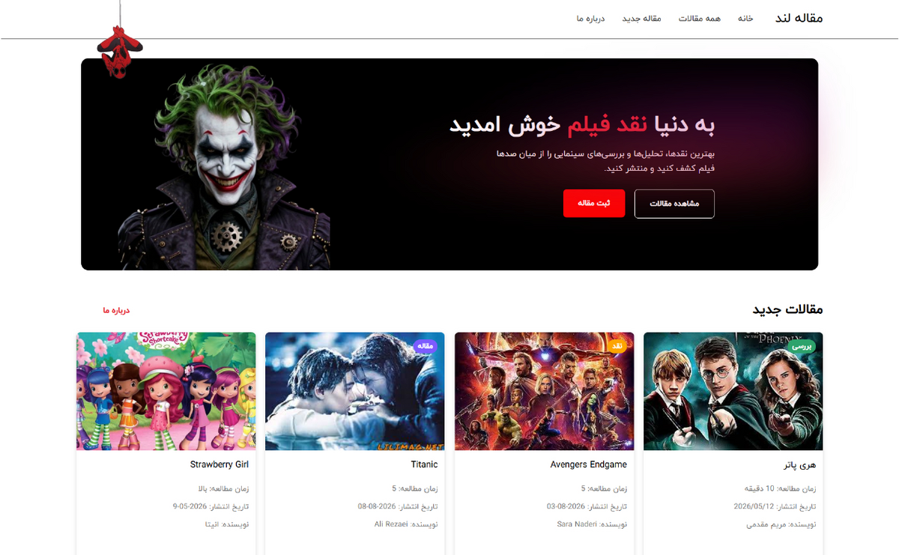

<div dir="rtl" align="right">

<div align="center">

# 🎬 مقاله لند (Movie Land)

**پلتفرم فارسی برای خواندن و انتشار نقد و بررسی فیلم و سریال**

[](https://movie-land-sage.vercel.app/)
[](LICENSE)

[**مشاهده دمو**](https://movie-land-sage.vercel.app/) · [English](README.md)



</div>

---

## درباره پروژه

مقاله لند یک وب‌اپلیکیشن React است که در آن می‌توانید نقد و تحلیل فیلم و سریال بخوانید، مقاله‌ی کامل هر کدام را ببینید و مقاله‌ی خودتان را ثبت کنید. رابط کاربری کاملاً راست‌به‌چپ است، از فونت فارسی استفاده می‌کند و روی موبایل و دسکتاپ خوب نمایش داده می‌شود.

این پروژه را برای تمرین ساخت یک پروژه‌ی واقعی فرانت‌اند از ابتدا تا استقرار ساختم: معماری کامپوننتی، مسیریابی سمت کلاینت، دریافت داده از سرور، فرم‌ها و دیپلوی.

## امکانات

- صفحه‌ی اصلی با بخش معرفی (Hero) و دکمه‌های مشاهده و ثبت مقاله
- نمایش جدیدترین مقالات همراه با دسته‌بندی، زمان مطالعه، تاریخ و نویسنده
- صفحه‌ی همه‌ی مقالات
- صفحه‌ی جزئیات هر مقاله با مسیر داینامیک
- چهار دسته‌بندی: تحلیل، بررسی، نقد، مقاله
- فرم ثبت مقاله‌ی جدید که مستقیم در دیتابیس ذخیره می‌شود
- طراحی ریسپانسیو و منوی موبایل
- صفحه‌ی ۴۰۴ اختصاصی و حالت لودینگ

## تکنولوژی‌ها

React 19 · Vite · React Router · Supabase · CSS · Oxlint · Vercel

## نصب و اجرا

پیش‌نیازها: Node.js نسخه‌ی ۲۰ یا بالاتر و یک پروژه‌ی رایگان [Supabase](https://supabase.com/).

</div>

```bash
git clone https://github.com/ashirzadian3-prog/movie-land.git
cd movie-land/tiDolist

npm install

cp .env.example .env
# مقدارهای Supabase را در فایل .env وارد کنید

npm run dev
```

<div dir="rtl" align="right">

برنامه روی `http://localhost:5173` اجرا می‌شود.

### متغیرهای محیطی

| متغیر                           | توضیح                         |
| ------------------------------- | ----------------------------- |
| `VITE_SUPABASE_URL`             | آدرس پروژه‌ی Supabase         |
| `VITE_SUPABASE_PUBLISHABLE_KEY` | کلید عمومی (publishable) کلاینت |

> فایل `.env` را هرگز commit نکنید. کلید `service_role` را هم هیچ‌وقت در فرانت‌اند استفاده نکنید.

### ساخت جدول دیتابیس

فایل [`docs/schema.sql`](docs/schema.sql) را در بخش SQL Editor پروژه‌ی Supabase اجرا کنید. برای پر کردن جدول با مقاله‌های نمونه می‌توانید از [`data/db.json`](data/db.json) استفاده کنید.

## اسکریپت‌ها

| دستور             | کار                          |
| ----------------- | ---------------------------- |
| `npm run dev`     | اجرای سرور توسعه             |
| `npm run build`   | ساخت نسخه‌ی نهایی            |
| `npm run preview` | پیش‌نمایش نسخه‌ی نهایی       |
| `npm run lint`    | بررسی کد با Oxlint           |

## مشارکت

مشارکت شما خوشحالم می‌کند. قبل از ارسال Pull Request فایل [CONTRIBUTING.md](CONTRIBUTING.md) را بخوانید.

## لایسنس

این پروژه با لایسنس MIT منتشر شده است. جزئیات در فایل [LICENSE](LICENSE).

## سازنده

**A Shirzadian** — [@ashirzadian3-prog](https://github.com/ashirzadian3-prog)

</div>
