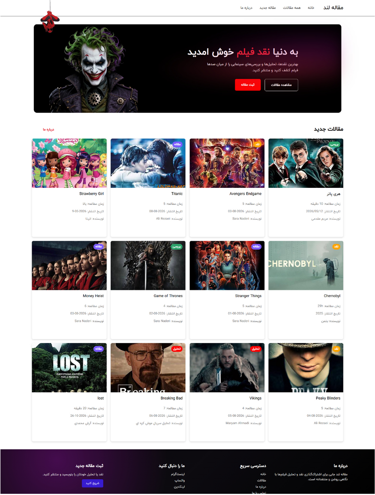

<div align="center">

# 🎬 Movie Land

**A Persian (RTL) platform for reading and publishing movie & series reviews.**

[](https://movie-land-sage.vercel.app/)
[](https://github.com/ashirzadian3-prog/movie-land/actions/workflows/ci.yml)
[](LICENSE)


[**Live Demo**](https://movie-land-sage.vercel.app/) · [**فارسی**](README.fa.md) · [Report a Bug](../../issues/new?template=bug_report.md) · [Request a Feature](../../issues/new?template=feature_request.md)


</div>

---

## Table of Contents

- [About](#about)
- [Features](#features)
- [Tech Stack](#tech-stack)
- [Getting Started](#getting-started)
- [Supabase Setup](#supabase-setup)
- [Available Scripts](#available-scripts)
- [Project Structure](#project-structure)
- [Routes](#routes)
- [Deployment](#deployment)
- [Roadmap](#roadmap)
- [Contributing](#contributing)
- [License](#license)
- [Author](#author)

## About

Movie Land (**مقاله لند**) is a content-driven React application where visitors can discover film and TV reviews, read full articles, and submit their own. The interface is fully right-to-left, uses a Persian web font, and adapts to desktop and mobile screens.

I built it to practice shipping a real frontend project end to end: component architecture, client-side routing, remote data fetching, form handling, and deployment.

<details>
<summary><b>Full-page preview</b></summary>
<br>

</details>

## Features

- **Hero landing section** with calls to action for browsing and publishing
- **Latest articles grid** on the home page, with category badges, reading time, publish date and author
- **All articles page** with the complete collection
- **Article detail pages** with dynamic routing (`/Articlepage/:id`)
- **Four content categories:** تحلیل (Analysis), بررسی (Review), نقد (Critique), مقاله (Article)
- **Article submission form** that saves new articles directly to the database
- **Right-to-left layout** with a Persian typeface (IRANYekan)
- **Responsive design** with a mobile navigation menu
- **Loading states** and a custom **404 page**

## Tech Stack

| Area      | Technology                                                  |
| --------- | ----------------------------------------------------------- |
| UI        | [React 19](https://react.dev/)                              |
| Build     | [Vite](https://vite.dev/)                                   |
| Routing   | [React Router](https://reactrouter.com/)                    |
| Backend   | [Supabase](https://supabase.com/) (Postgres + REST client)  |
| Styling   | Plain CSS, one stylesheet per component                     |
| Linting   | [Oxlint](https://oxc.rs/)                                   |
| Hosting   | [Vercel](https://vercel.com/)                               |

## Getting Started

### Prerequisites

- [Node.js](https://nodejs.org/) 20 or newer
- npm (bundled with Node.js)
- A free [Supabase](https://supabase.com/) project (see [Supabase Setup](#supabase-setup))

### Installation

```bash
# 1. Clone the repository
git clone https://github.com/ashirzadian3-prog/movie-land.git
cd movie-land/tiDolist

# 2. Install dependencies
npm install

# 3. Create your environment file
cp .env.example .env
# then fill in your Supabase URL and publishable key

# 4. Start the dev server
npm run dev
```

The app will be available at `http://localhost:5173`.

### Environment Variables

| Variable                        | Description                                  |
| ------------------------------- | -------------------------------------------- |
| `VITE_SUPABASE_URL`             | Your Supabase project URL                    |
| `VITE_SUPABASE_PUBLISHABLE_KEY` | Your Supabase publishable (anon) client key  |

> Never commit your `.env` file. It is already listed in `.gitignore`. Only use the **publishable** key in the browser, never the `service_role` key.

## Supabase Setup

The app reads from and writes to a single `articles` table. Create it from the SQL editor in your Supabase dashboard using [`docs/schema.sql`](docs/schema.sql).

This file also enables Row Level Security with policies that allow public reads and inserts, which matches how the app works today. Review those policies before using the project in production.

Sample content is available in [`data/db.json`](data/db.json) if you want to seed the table with starter articles.

## Available Scripts

Run these from the `tiDolist/` directory:

| Command           | Description                              |
| ----------------- | ---------------------------------------- |
| `npm run dev`     | Start the development server with HMR    |
| `npm run build`   | Create an optimized production build     |
| `npm run preview` | Preview the production build locally     |
| `npm run lint`    | Lint the source code with Oxlint         |

## Project Structure

```text
movie-land/
├── .github/                 # CI workflow, issue and PR templates
├── data/
│   └── db.json              # Sample articles for seeding
├── docs/
│   ├── images/              # README screenshots
│   └── schema.sql           # Database schema for Supabase
└── tiDolist/                # The React application
    ├── public/
    └── src/
        ├── assets/          # Images and fonts
        ├── components/      # Reusable UI (Navbar, Footer, Article, Loading...)
        ├── pages/           # Route-level pages (Home, Allarticles, About, Contact, Error404)
        ├── App.jsx          # Route definitions
        ├── main.jsx         # Application entry point
        └── supabaseClient.js
```

## Routes

| Path                | Page                         |
| ------------------- | ---------------------------- |
| `/`                 | Home                         |
| `/article`          | All articles                 |
| `/Articlepage/:id`  | Single article               |
| `/contact`          | Submit a new article         |
| `/about`            | About                        |
| `*`                 | 404 Not Found                |

## Deployment

The project is deployed on Vercel. To deploy your own copy:

1. Import the repository into Vercel.
2. Set the **Root Directory** to `tiDolist`.
3. Add `VITE_SUPABASE_URL` and `VITE_SUPABASE_PUBLISHABLE_KEY` as environment variables.
4. Deploy. Vercel detects Vite automatically (build command `npm run build`, output directory `dist`).

A [`vercel.json`](tiDolist/vercel.json) rewrite is included so direct links to inner pages (for example `/about`) work with client-side routing.

## Roadmap

- [ ] Search and category filtering on the articles page
- [ ] Pagination or infinite scroll
- [ ] Form validation with inline error messages and success feedback
- [ ] User authentication so only signed-in users can publish
- [ ] Edit and delete for article authors
- [ ] View counter and popular articles section
- [ ] SEO improvements (per-article titles and meta tags)
- [ ] Dark mode

Have an idea? [Open an issue](../../issues/new?template=feature_request.md).

## Contributing

Contributions, issues and feature requests are welcome. Please read [CONTRIBUTING.md](CONTRIBUTING.md) before opening a pull request.

## License

Distributed under the MIT License. See [LICENSE](LICENSE) for details.

## Author

**A Shirzadian**

- GitHub: [@ashirzadian3-prog](https://github.com/ashirzadian3-prog)

If you like this project, consider giving it a ⭐

## Admin Panel

An admin panel lives at `/admin` (login at `/admin/login`). It lets signed-in admins view stats, and create, edit, search and delete articles.

1. Run `docs/schema.sql`, then `docs/admin.sql` in the Supabase SQL Editor.
2. Create a user in Supabase: Authentication → Users → Add user.
3. Make that user an admin by running the `insert into public.admins ...` snippet at the bottom of `docs/admin.sql`.
